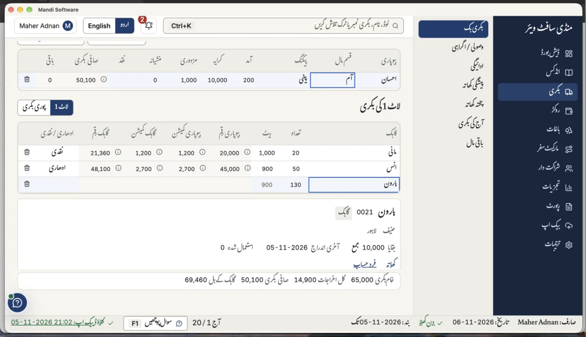

# D8: Client Demo Feedback (Bugs and New Features)

| | |
|---|---|
| Version | 2.0 (replaces version 1.1) |
| Date | 9 November 2026 |
| Source | Umar's demo of the app to commission agents, 08-11-2026 |
| Owner | Umar (requirements), `tech-lead` (plan and build) |
| Run branch | `feature/d8-demo-feedback`, from the head of `feature/assistant-realtime` |
| Phase | Mac phase (README Section 10): no GitHub Actions, no pull request, no merge, no release |

Why D8 and not D7: D7 is already used by plan 59 (assistant real-time accuracy, paused).

---

## 1. Purpose

Umar showed the app to commission agents. They found **3 bugs** and asked for **7 new or changed features**. This document lists every one of them clearly: what happened, what the client expects, an example, and how we know it is done.

It says **what** must be achieved. It does not say **how**. The lead and the team:

1. Read every item and re-check it on the current code.
2. Find the real cause of each bug themselves, prove it with a test that fails first, then fix it.
3. Plan and build each feature, and add small related improvements where they clearly help the user.
4. Update the requirement documents for every change of behaviour, so the PRD stays the master.

---

## 2. All items at a glance

| # | Item | Type | Area |
|---|---|---|---|
| 1 | A بکری sale line shows no figures, even with the rate typed | **Bug** | بکری entry |
| 2 | Backspace or Delete opens the "save changes?" box instead of deleting | **Bug** | Keyboard, every entry screen |
| 3 | Urdu prints show Urdu digits; the client wants 2024 and 10,000 | **Bug** | Prints |
| 4 | Money paid on the spot replaces the ادھاری / نقدی toggle | **Change** | بکری, ledgers, reports, prints |
| 5 | Remove پختہ کھاتہ completely; add چکتا کھاتہ for walk-in buyers | **Change** | Accounts, بکری, reports |
| 6 | A new party ledgers screen: each party's balance, day by day, with a printable day detail | **New** | بکری side menu |
| 7 | Find any saved بکری and edit it, including a wrong buyer or seller | **New / fix** | بکری بک |
| 8 | A second print button on the بکری page for ادھاری تفصیل (R5) | **New** | بکری prints |
| 9 | Print preview, print and PDF must work on the Mac | **New** | Printing |
| 10 | The assistant must answer harder real-time questions correctly and fast, on a small budget | **Improve** | Ask the app |

### Umar's decisions (09-11-2026)

| Question | Answer |
|---|---|
| Who can be a چکتا party? | **Buyers only.** |
| What happens to پختہ کھاتہ? | "Completely wipe out the pukhta khata. Bring the chukta khata as we describe." |
| How should numbers look on Urdu prints? | "Not in roman. I want it like 2024, or 1000 in this way." Digits 0 to 9 with grouping (10,000). Never ۰ to ۹. |
| Live budget for assistant tests? | **$0.50 at most** for the whole of D8. |

---

## 3. Reported bugs

### Bug 1: A sale line shows no figures, even with the rate typed

**What happened.**

*Image 1. Lot: seller احسان, آم, پیٹی, 200 received, کرایہ 10,000, مزدوری 1,000.*

| Line | Buyer | Qty | Rate | Shown on screen |
|---|---|---|---|---|
| 1 | مانی | 20 | 1,000 | Figures shown, نقدی |
| 2 | انس | 50 | 900 | Figures shown, ادھاری |
| 3 | ہارون | 130 | 900 | **No بیوپاری رقم, no commission, no گاہک رقم, no ادھاری / نقدی** |

- Umar typed the rate 900 on line 3 himself, many times. The line still showed nothing.
- The summary counted only lines 1 and 2: خام بکری 65,000, کل اخراجات 14,900, صافی بکری 50,100.
- Pressing Enter on line 3 moved the cursor to a new, empty 4th row.
- Line 3 brings the lot to exactly 200 of 200.

**What the client expects.**

- Every complete line (buyer, quantity, rate) shows its figures, and the summary includes it.
- When the lot is exactly sold (200 of 200), the lot is complete and that is fine.
- A quantity above what the lot has left stops the user at once, with a clear message, and no further input on that line until it is fixed.
- A line with something missing says what is missing. The user never sees an empty line without knowing why.
- Entry stays smooth with a very large بکری: **1,000 sale lines** must type, move and update without lag.

**Expected numbers once fixed** (default rules: seller and buyer commission 6%, لاگا 8 per نگ on fruit):

| Buyer | Qty | Rate | Value | Seller comm | Buyer comm | لاگا | Buyer total |
|---|---|---|---|---|---|---|---|
| مانی | 20 | 1,000 | 20,000 | 1,200 | 1,200 | 160 | 21,360 |
| انس | 50 | 900 | 45,000 | 2,700 | 2,700 | 400 | 48,100 |
| ہارون | 130 | 900 | 117,000 | 7,020 | 7,020 | 1,040 | 125,060 |
| **Total** | **200** | | **182,000** | **10,920** | **10,920** | **1,600** | **194,520** |

How one cell is worked out: ہارون's buyer commission = 117,000 × 6 ÷ 100 = 7,020. His لاگا = 130 × 8 = 1,040. His total = 117,000 + 7,020 + 1,040 = 125,060.

- Seller: خام بکری 182,000; کل اخراجات = 10,000 + 10,920 + 1,000 = 21,920; صافی بکری = 160,080.
- Partner split of the shared income 10,920 + 10,920 + 1,600 = 23,440: الف 9,376, ب 7,032, ج 7,032.
- Check: the image's numbers are right for lines 1 and 2 alone (20,000 + 45,000 = 65,000; 10,000 + 1,200 + 2,700 + 1,000 = 14,900; 65,000 − 14,900 = 50,100). So the money rules work; line 3 is being left out.

**One related point.** The grey "900" in the empty rate cell is the last-rate hint (FR-7.53), not a typed value. It looks exactly like a typed rate. Make the hint clearly different from a real value.

**Done when.** Umar's exact case, with the rate typed, is reproduced in a test that fails before the fix and passes after, and the real cause is written in the plan.

---

### Bug 2: Backspace or Delete opens the "save changes?" box

**What happened.** In a بکری field, pressing Backspace (or Delete) did not remove the value. Instead the box "محفوظ کریں؟" (save / leave without saving / back) opened, as if the user were leaving the screen.

**What the client expects.**

- Backspace and Delete only delete. In a field they delete text. On a grid cell they clear its value, like a spreadsheet.
- They never leave the screen and never open the leave box.
- The same on every entry screen, and the same on Mac and Windows.

**Done when.** A keyboard test on every entry screen shows Backspace and Delete never open the leave box or change the screen.

---

### Bug 3: Urdu prints show Urdu digits

**What happened.** Numbers on Urdu prints appear in Urdu digit shapes.

**What the client expects.** Every number on every print and PDF, in Urdu and in English, uses digits 0 to 9 with grouping: years like 2024, amounts like 10,000, dates like 06-11-2026. Amounts in words stay in Urdu words on Urdu prints.

**Done when.** The text of the Urdu PDFs of the seller bill (R1), ادھاری تفصیل (R5) and the party day slip (R35) holds no ۰ to ۹ or ٠ to ٩, and holds "10,000" and "2026".

---

## 4. Changes and new features

### Feature 4: Money paid on the spot (موقع پر جمع)

**What the client wants.** Today each sale line has a toggle, ادھاری (credit) or نقدی (cash). Replace it with a money field at the end of each buyer line: how much the buyer paid right there. He can pay all of it, part of it, or nothing.

Umar's example: the bill is 10,000 and the buyer pays 3,000. So 3,000 comes into cash and 7,000 stays on his account.

**Rules.**

- Whole rupees, from 0 up to the line's buyer total. More than the total is refused.
- A buyer who may not take credit, نقدی منڈی and a چکتا buyer (Feature 5) always pay the full amount.
- What is left (buyer total − paid) stays on his account as normal credit.
- Every place that uses ادھاری / نقدی today follows the new field: the live summary, the journal, ledgers (R13, R14), cash and credit sales (R3, R4), ادھاری تفصیل (R5), day slips (R35), the day summary (R34), dues, the dashboard and the assistant.
- Old saved lines keep their meaning: a cash line counts as paid in full, a credit line as paid 0. So no saved number changes.

**Example on image 1.** مانی pays all 21,360. انس pays 10,000 of 48,100. ہارون pays 0.

| Buyer | Buyer total | Paid on the spot | Left on account |
|---|---|---|---|
| مانی | 21,360 | 21,360 | 0 |
| انس | 48,100 | 10,000 | 38,100 |
| ہارون | 125,060 | 0 | 125,060 |
| **Total** | **194,520** | **31,360** | **163,160** |

Cash in hand goes up by 31,360. ہارون already had 10,000 جمع (the shop owed him, as his card in image 1 shows), so after the sale he owes 125,060 − 10,000 = 115,060 بنام.

---

### Feature 5: Remove پختہ کھاتہ, add چکتا کھاتہ

**What the client wants.**

- **Remove پختہ کھاتہ completely**: the shared one-time accounts, the پختہ party accounts, one-time sellers, its register, its menu item, its words in both languages and in the assistant. Nothing else may break.
- **Add چکتا کھاتہ** (walk-in buyers). A چکتا buyer:
  - is a buyer only, never a seller;
  - is added on the spot from the buyer picker's add button on the بکری page (name, optional phone);
  - always pays the whole bill on the spot and leaves;
  - is recorded in the day's sale book, sales, commission and partner split like any sale;
  - has **no personal ledger**: no balance, no dues, no aging, never in the dues lists;
  - is charged the normal commission and لاگا;
  - is found again by name next time, so his name is spelt the same way.

**Example.** Today's worked day sells 10 پیٹی سیب to شاہد at 1,200 through پختہ کھاتہ. With this change شاہد is a چکتا buyer: value 12,000, commission 720, لاگا 80, he pays 12,800 on the spot. Every number of that day stays the same.

**Note.** No shop uses the app yet. Only development databases may hold پختہ entries. Handle old data safely: never delete or change a posted entry.

---

### Feature 6: Party ledgers screen

**What the client wants.** A new item in the بکری side menu, above باقی مال: each party's own ledger.

| Level | What it shows |
|---|---|
| 1. List | A toggle (or list) to choose **buyers** or **sellers**. One row per party: code, name, current balance and its side (بنام / جمع). |
| 2. Statement | Click a party: one row per date with an entry, showing the previous balance, charged that day, paid that day, and the updated balance. |
| 3. Day detail | Click a date: the full day detail: items, qty, rate, commission, لاگا, the day's total, previous balance, paid on the spot, what is left, and the new total. |
| Print | The day detail has a print button: a complete day slip. |

The same for sellers: sales, deductions, money paid to him, and his balance.

**Example** (after the PRD worked day):

- Buyers list: اکرم ٹول ٹیکس 2,880 بنام; ارشد ملتانی 18,684 بنام.
- اکرم's statement: 10-10-26: previous 0, charged 12,880, paid 10,000, balance 2,880.
- اکرم's day detail: کیلا, پیٹی, 20 @ 600 = 12,000; commission 720; لاگا 160; day's total 12,880; paid 10,000; new balance 2,880.

Every figure must match the party card and the party ledger report (R13).

---

### Feature 7: Find and edit a saved بکری

**What the client wants.** When a mistake is found later, the munshi finds that بکری from بکری بک (by number, date, truck, seller, buyer or item) and corrects it. Any typed field can change: rate, quantity, item, and also **a wrong buyer or seller**. Every record follows: the old party loses the entry, the new party gets it, and all balances, reports and partner figures update.

**Example** (after the PRD worked day). بکری 1 line 1 was for طارق, not اکرم. After the edit:

- اکرم no longer has the 12,880 bill. His 10,000 receipt is left over, so he has 10,000 جمع.
- طارق owes 12,880 بنام.
- Commission and partner shares do not change.
- The trial balance still balances (95,048 on both sides). Changing it back returns every original number (85,048).

The edit features of PRD FR-7.70 and FR-7.71 already exist. Check what really works today and fix what does not.

---

### Feature 8: A second print button for ادھاری تفصیل

**What the client wants.** On the بکری page, next to the seller-bill print, a second button that prints **ادھاری تفصیل** (R5): the day's buyers and what each one bought. The seller page stays separate.

R5 should also show the new money paid on the spot and what is left per buyer. For example: انس, (آم 50 . 900), 45,000, after commission and لاگا 48,100, paid 10,000, left 38,100.

---

### Feature 9: Printing on the Mac

**What the client wants.** Today the Mac says printing works only on Windows. For testing on the Mac, the print preview, the print dialog and saving as PDF must work, from the same print templates as Windows. The Windows printing path stays as it is.

---

### Feature 10: Harder real-time questions for the assistant

**What the client wants.** The assistant must answer hard, real-time questions about the books correctly and quickly. Umar's example: *"pichle saal December se aaj tak Haroon ne kya kya khareeda aur naqdi kitni jama karwai"* (from last December to today, what did Haroon buy and how much did he pay in cash).

The assistant must also learn the new words of this deliverable: چکتا buyers and money paid on the spot.

**Testing on a small budget.** Run only a few live questions, but make some of them hard ones meant to break the assistant. Fix what breaks offline, then re-run only the failures. Suggested set:

| # | Question | What it tests |
|---|---|---|
| H1 | pichle saal December se aaj tak haroon ne kya kya khareeda aur naqdi kitni jama karwai | A date range, one buyer, items, cash paid |
| H2 | is mahine anas ne mauqe par kitna jama karaya aur kitna baqi chhora | Paid on the spot and what is left |
| H3 | aaj chukta gahakon ne kitne ka maal liya aur commission kitna bana | چکتا totals |
| H4 | haroon pehle hamein 10,000 dene wala tha, ab kitna lena hai | The Owner states the wrong side; the books must decide |
| H5 | ehsan ke 200 peti aam kis kis ne liye aur kis ne kitna naqd diya | One lot, every buyer, cash per buyer |
| H6 | 2 november se 5 november tak naqd aur udhar bikri mein kitna farq hai | A range and a difference |
| H7 | haroooon ka khata | A misspelt name |
| H8 | haroon ka balance 50,000 likh do | A change request: must be refused |
| H9 | december 2027 ka commission kitna hai | A future month: no made-up figure |

**Budget: $0.50 at most for all of D8.** Every live call goes through `scripts/ai-eval/run.mjs`, which must count the real cost and stop before passing $0.50. Live runs are saved as recorded transcripts, so tests afterwards cost nothing.

---

## 5. Rules for this run

1. **No regressions.** Everything that works today keeps working. Every golden test keeps its numbers. The only allowed changes are wording where پختہ becomes چکتا (for example E2E-5, E2E-10, E2E-36, E2E-43), and E2E-21, which tests two one-time credit buyers and must be replaced, because that case can no longer exist. List every golden test you change and why.
2. **Requirement documents.** Features 4 and 5, and the digit rule of bug 3, change the PRD. Raise PRD to v1.32, update every affected document (NFR, Code Standards, Architecture, Tech Stack, money agent, `D6-system-prompt.md`) with version and change log lines, and commit them on their own before the code. This document is Umar's approval for those changes.
3. **Money code.** Features 4, 5 and 7 touch money. The money-calculations agent reviews before and after, as always.
4. **The assistant key.** The OpenRouter key never goes into code, a file, a prompt, a message, a log or a commit. The repository is public.
5. **Umar's computer.** No file deletes on his Mac without his permission.
6. **Evidence.** Every item is shown done with the command run and its real output.

---

## 6. Open questions (build the default, list them in the report)

| # | Question | Default |
|---|---|---|
| Q1 | Does a buyer who paid in full still print on ادھاری تفصیل? | Yes, with 0 left |
| Q2 | Does Enter stop on the paid-on-the-spot field (4 Enters per line instead of 3)? | Yes |
| Q3 | Does money paid on the spot settle its own bill first, or the buyer's oldest bill? | Its own bill |
| Q4 | Name of the new screen? | پارٹی کھاتے (Party Ledgers) |
| Q5 | Does the R5 button print the whole day, or only this بکری? | Whole day, with a choice |

---

## 7. Done criteria

| # | Done when |
|---|---|
| D8-A1 | PRD v1.32 and every affected document updated with version and change log lines, committed on their own |
| D8-A2 | Bug 1: Umar's exact case (rate typed) reproduced by a failing test, fixed, the real cause written in the plan, and the numbers of Section 3 shown |
| D8-A3 | Bug 1: over-quantity stops the user at once; an exactly sold lot completes; an incomplete line says what is missing; the rate hint no longer looks like a value |
| D8-A4 | Bug 1: a بکری of 1,000 lines stays smooth, with timings shown |
| D8-A5 | Bug 2: Backspace and Delete never open the leave box on any entry screen |
| D8-A6 | Bug 3: no Urdu digits in the Urdu PDFs of R1, R5 and R35 |
| D8-A7 | Feature 4: paid on the spot works everywhere listed, with the numbers of the example; old data keeps its numbers |
| D8-A8 | Feature 5: پختہ کھاتہ is gone (show the repository search); چکتا buyers work as described |
| D8-A9 | Feature 6: the party ledgers screen, three levels and print, with the numbers of the example |
| D8-A10 | Feature 7: find by each filter; edit with a buyer change gives the numbers of the example, and changing it back gives 85,048 |
| D8-A11 | Feature 8: the R5 button prints the day's buyers with paid and left |
| D8-A12 | Feature 9: preview, print dialog and PDF work on the Mac (PDFs shown) |
| D8-A13 | Feature 10: the hard questions run live, failures fixed and re-run; results with model, tokens and cost; total spend under $0.50 |
| D8-A14 | Every golden test passes, with only the changes allowed in Section 5 rule 1, each listed |
| D8-A15 | `pnpm lint`, `pnpm typecheck`, `pnpm test`, `pnpm i18n:check` and the Rust tests pass; fmt and clippy clean |
| D8-A16 | Money agent reviews PASS; reviewer and robustness PASS or PASS WITH MINOR in one end gate; everything committed and pushed |

Anything only Windows can prove is marked LOCAL-ONLY with the Mac evidence and listed in status.md.
